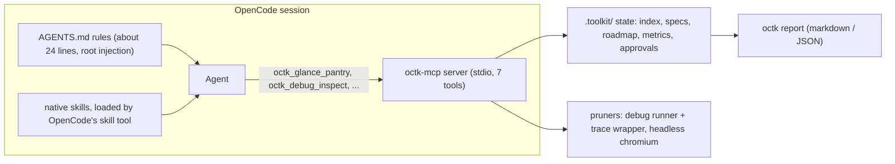
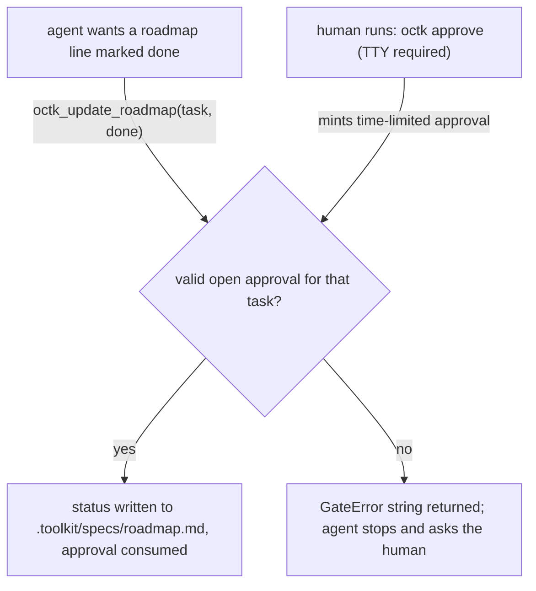

# octk — the OpenCode toolkit

octk keeps an AI coding agent's context small, gates roadmap completion behind
out-of-band human approval, and records honest metrics. It ships as a Python
CLI (`octk`) plus a local MCP server (`octk-mcp`) that OpenCode mounts.

Three ideas, enforced:

1. **Lazy context.** The pantry index is tiny; specs and skills load on demand.
   Debug and browser output is pruned to project-local frames and signals.
2. **The approval gate.** No agent marks a roadmap item done on its own.
   `octk approve "<task>"` runs in the human's terminal (TTY required) and
   mints a one-time, time-limited approval the agent can then spend.
3. **Honest metrics.** Every number is labeled `measured`, `counterfactual`,
   or `load`. Savings are computed from real runs; retention of required
   signals is scored, never assumed. Nothing is hand-pasted.

## Architecture



- **AGENTS.md** is the only always-loaded surface: about 24 rendered lines.
- **Native** `.opencode/skills/` stay native. `octk_equip_skill` serves only
  extra files dropped into `.toolkit/skills/` (project-specific knowledge that
  is not worth a native skill).
- Tool names are prefixed with your configured `server_name` (default `octk`),
  so `octk_glance_pantry` might be `mykit_glance_pantry` on another project.

## The approval gate



The generated `opencode.json` rules also deny the agent any shell `octk approve *` call and any edit of
`.toolkit/approvals.json` or `.toolkit/metrics.json`, and turn roadmap edits into an
ask:

```json
{
  "mcp": {
    "servers": {
      "octk": {"type": "local", "command": ["octk-mcp"], "codemode": false}
    }
  },
  "permissions": [
    {"action": "shell", "resource": "octk approve *", "effect": "deny"},
    {"action": "edit", "resource": ".toolkit/approvals.json", "effect": "deny"},
    {"action": "edit", "resource": ".toolkit/metrics.json", "effect": "deny"},
    {"action": "edit", "resource": ".toolkit/specs/roadmap.md", "effect": "ask"}
  ]
}
```

> **Manual check, once:** after you first run `octk mcp-config` and merge the
> snippet, verify yourself that the `octk approve` shell rule is listed and
> that editing `.toolkit/approvals.json` from the agent asks or blocks. And a
> boundary in words: these rules stop a drifting agent, not a determined one
> (the agent still owns a shell); the gate's real teeth are the TTY gate and
> the warning you just verified.

## Quickstart

```bash
# in the octk checkout
uv sync

# in the project you want the toolkit for
octk init                       # idempotent scaffold (AGENTS.md, .toolkit/, ideate command)
octk mcp-config                 # print the opencode.json snippet above; paste and merge it
octk standing add bare --tokens-in 44000   # measure this AFTER a bare turn-1 prompt, exact from provider usage
octk standing add octk --tokens-in 44650   # your own numbers; see "Standing costs" below

octk task start <task> --mode with_octk --model <model>
# ... do the task with the agent ...
octk task end --status completed --tokens-in N --tokens-out M --turns K --check "pytest -q"
octk report                     # metrics → markdown or --json
```

## The seven MCP tools

| tool | reads/writes | what it returns |
|---|---|---|
| `*_glance_pantry` | index, spec/skill file names | one-screen inventory plus the measured raw/pruned byte delta |
| `*_equip_spec` | `.toolkit/specs/<name>.md` | full file text on demand |
| `*_equip_skill` | `.toolkit/skills/<name>.md` | full file text on demand (extras only) |
| `*_update_roadmap` | roadmap line status | gate-enforced status update |
| `*_run_audit_workflow` | graph freshness | instruct advice or configured audit run |
| `*_debug_inspect` | allowlisted pytest/python run | pruned failure output (project frames + signals) |
| `*_browser_inspect` | http/https URL | error/element summary of a headless-Chromium visit |

All well-behaved tools log a kind: `measured` (real raw-vs-pruned bytes),
`counterfactual` (real serve, estimated alternative), `load` (context octk
itself delivered). `equip_*` calls are `load`; `glance_pantry` is
`counterfactual`; pruner calls are `measured`.

## Honest measurement model

- `measured` — the raw bytes were actually captured, the pruned bytes actually
  returned. Headline numbers come only from here.
- `counterfactual` — the returned (small) part is real; the "would have
  loaded" part is an estimate. Reports keep these in a separate section.
- `load` — octk's own added context (MCP tool schema bytes, equip calls).
- Tokens are labeled "approx": the report uses the `chars/4` proxy for tool
  calls. Standing costs (below) are the exception: they are exact.
- If octk was worse on a metric, the report says so. The resume line appears
  only once 5+ paired tasks exist.

### Standing context costs (exact turn-1 input tokens)

`octk standing add <label> --tokens-in N` records a *measured* turn-1 input
token count (from your provider's usage readout, not the chars/4 proxy).
Use one `bare` record (no octk at all) and one per mounted surface; the report
shows delta vs `bare`.

| label | turn-1 input tokens | delta vs bare |
|---|---|---|
| bare | — | — |
| octk | — | — |

> This table is intentionally empty. It is filled by `octk report` output,
> never by hand.

## Tool bench

```bash
octk bench tools               # writes reports/BENCH_TOOLS.md
uv run octk bench tools --json # raw results as JSON on stdout
```

The bench builds throwaway fixtures in temp dirs, runs the pruners for real,
and scores two orthogonal things per case: **character savings** (raw vs
pruned) and **signal retention** (the fraction of required signals — test
name, exception class, local variable, console error, network 4xx — that
survive pruning). Retention is scored, never assumed; the CLI exits 1 when a
non-skipped case loses any signal. Browser cases are marked skipped, not
faked, when headless Chromium is unavailable. The current run is committed as
[`reports/BENCH_TOOLS.md`](reports/BENCH_TOOLS.md).

Schema overhead (the bytes the MCP server adds to the model-visible tool list)
and AGENTS.md root-injection bytes are reported as `load` context.

## Comparison tables (filled by generated reports only)

### Repo dogfood (paired tasks, with_octk vs without_octk)

| task | duration | turns | approx tokens | acceptance |
|---|---|---|---|---|
| — | — | — | — | — |

### Terminal-Bench / Harbor showcase (Phase I)

Hard tasks from `terminal-bench/terminal-bench-2-1` (debugging, data-science,
sysadmin, security, scientific computing, file operations, SE medium/hard)
plus one easy SE control where octk is expected **not** to help. One `octk`
worktree, one `bare` worktree; the showcase runs through
`harbor run --agent opencode -d <dataset>`.

| dataset task | category | octk result | bare result | turns (octk) | turns (bare) | note |
|---|---|---|---|---|---|---|
| — | — | — | — | — | — | — |

**Fairness rules (C8) for any octk-vs-base comparison:**

- Skills, MCP servers and plugins identical in both worktrees — or off in
  both. The only asymmetry allowed: octk's own MCP entry, its AGENTS.md rules
  and its `.toolkit/` state (with `bare` — the inverse).
- Review/critique skills pinned to an exact version, never `latest`.
- Same model, same prompts, same acceptance commands in both arms.
- Results are published from generated reports; nothing hand-pasted.

## Windows notes

- The pruner normalizes path separators and treats `.venv`, `venv`,
  `site-packages`, `Lib\site-packages`, `.venv\Scripts`, `node_modules`,
  `__pycache__` frames as third-party noise on both platforms.
- The roadmap writer preserves existing line endings; the parser uses
  `splitlines()`.
- Executables are located with `shutil.which`; subprocesses never get a shell.

## Configuration (`.toolkit/config.json`)

| key | default | meaning |
|---|---|---|
| `server_name` | `octk` | prefix for every tool name rendered in AGENTS.md / snippets |
| `always_on_skills` | `[]` | skills named in AGENTS.md's one-line always-on list |
| `audit_mode` | `instruct` | `instruct` advises (`/graphify .` then `/ponytail-review`); `subprocess` runs configured executables |
| `graph_report_paths` | `graphify-out/GRAPH_REPORT.md`, `graphify-out/graph.json` | freshness check inputs |
| `allowed_commands` | pytest, python(3), uv | allowlist for subprocess execution; no shell, ever |
| `command_timeout_s` / `max_output_chars` | 120 / 2500 | runner guardrails |
| `approval_ttl_minutes` | 120 | expiration for minted approvals |

## Development

```bash
uv sync
uv run pytest -q                 # full suite (includes headless-Chromium tests)
uv run pytest -q -m "not browser"  # skip browser tests
uv run playwright install chromium # once, for browser tests
```

Design conventions live in [`docs/DESIGN.md`](docs/DESIGN.md) (module map,
kinds, purity rules, atomic writes, honesty rules). Reports are committed
under `reports/`; `.toolkit/metrics.json`, `.toolkit/approvals.json`,
`graphify-out/` and `.venv/` are gitignored — metrics and approvals are
machine state, not source.
