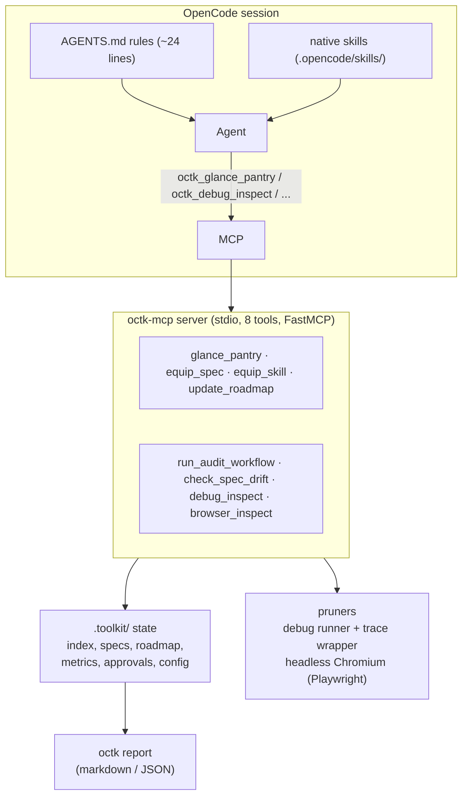
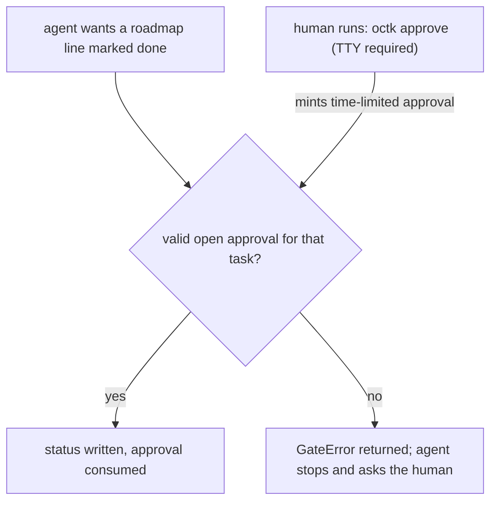

# octk — the OpenCode toolkit

`octk` keeps an AI coding agent's context small, gates roadmap completion
behind out-of-band human approval, and records honest metrics. It ships as a
Python CLI (`octk`) plus a local MCP server (`octk-mcp`) that OpenCode mounts.

Three ideas, enforced:

1. **Lazy context.** The pantry index is tiny; specs and skills load on demand.
   Debug and browser output is pruned to project-local frames and signals.
2. **The approval gate.** No agent marks a roadmap item done on its own.
   `octk approve "<task>"` runs in the human's terminal (TTY required) and
   mints a one-time, time-limited approval the agent can then spend.
3. **Honest metrics.** Every number is labeled `measured`, `counterfactual`,
   or `load`. Savings are computed from real runs; retention of required
   signals is scored, never assumed. Nothing is hand-pasted.

## Problem statement

Coding agents lose time and money in three predictable ways:

- **Context dumping.** The whole spec tree, skill files, and tool schemas are
  injected into Turn 1, so even a one-line fix pays for tens of thousands of
  input tokens before any work happens.
- **Self-approval.** An agent asked to "mark the roadmap done" will often do it,
  because nothing in the harness stops it. Tests pass, but the human never
  reviewed the change.
- **Unverifiable savings.** Tooling claims "90% fewer tokens" without showing
  raw-vs-pruned bytes or whether the pruned output still contains the signal
  needed to debug.

`octk` addresses all three: a JIT-loaded pantry instead of a context dump, a
TTY-gated approval with a real spend-once token, and a measurement model that
labels every number by how it was obtained.

## Architecture



- **AGENTS.md** is the only always-loaded surface: about 24 rendered lines.
- **Native** `.opencode/skills/` stay native. `octk_equip_skill` serves only
  extra files dropped into `.toolkit/skills/` (project-specific knowledge that
  is not worth a native skill).
- Tool names are prefixed with your configured `server_name` (default `octk`),
  so `octk_glance_pantry` might be `mykit_glance_pantry` on another project.

## The approval gate



The generated `opencode.json` rules also deny the agent any shell
`octk approve *` call and any edit of `.toolkit/approvals.json` or
`.toolkit/metrics.json`, and turn roadmap edits into an ask:

```json
{
  "mcp": {
    "servers": {
      "octk": {"type": "local", "command": ["octk-mcp"], "codemode": false}
    }
  },
  "permissions": [
    {"action": "shell", "resource": "octk approve *", "effect": "deny"},
    {"action": "edit", "resource": ".toolkit/approvals.json", "effect": "deny"},
    {"action": "edit", "resource": ".toolkit/metrics.json", "effect": "deny"},
    {"action": "edit", "resource": ".toolkit/specs/roadmap.md", "effect": "ask"}
  ]
}
```

> **Manual check, once:** after you first run `octk mcp-config` and merge the
> snippet, verify yourself that the `octk approve` shell rule is listed and
> that editing `.toolkit/approvals.json` from the agent asks or blocks. These
> rules stop a drifting agent, not a determined one (the agent still owns a
> shell); the gate's real teeth are the TTY gate and the warning you just
> verified.

## Quickstart

```bash
# in the octk checkout
uv sync

# in the project you want the toolkit for
octk init                       # idempotent scaffold (AGENTS.md, .toolkit/, ideate command)
octk mcp-config                 # print the opencode.json snippet above; paste and merge it
octk standing add bare --tokens-in 44000   # measure this AFTER a bare turn-1 prompt
octk standing add octk --tokens-in 44650   # your own numbers; see "Standing costs" below

octk task start <task> --mode with_octk --model <model>
# ... do the task with the agent ...
octk task end --status completed --tokens-in N --tokens-out M --turns K --check "pytest -q"
octk report                     # metrics -> markdown or --json
```

## CLI reference

| command | purpose |
|---|---|
| `octk init [--force]` | scaffold `AGENTS.md`, `.toolkit/`, `.opencode/agents`, `opencode.json` |
| `octk mcp-config` | print the `opencode.json` MCP snippet (V2 syntax) |
| `octk models` | list the 4 octk agents and their model/effort |
| `octk set-model <agent> <model>` | set an agent's model |
| `octk set-effort <agent> <level>` | set an agent's effort level |
| `octk task start <task> --mode ... --model ...` | open a task run in the metrics store |
| `octk task end --status ... --tokens-in N ...` | close a task run with check result |
| `octk approve "<task>"` | mint a one-time, TTY-gated approval (human only) |
| `octk report` | build the metrics report (`--json` for machine output) |
| `octk standing add <label> --tokens-in N` | record an exact turn-1 input token count |
| `octk bench tools [--out PATH] [--json]` | score pruners on generated fixtures |

Slash commands (OpenCode side): `/ideate` interviews, blueprints, and scaffolds.

## The eight MCP tools

| tool | reads/writes | what it returns |
|---|---|---|
| `*_glance_pantry` | index, spec/skill file names | one-screen inventory plus the measured raw/pruned byte delta |
| `*_equip_spec` | `.toolkit/specs/<name>.md` | full file text on demand |
| `*_equip_skill` | `.toolkit/skills/<name>.md` | full file text on demand (extras only) |
| `*_update_roadmap` | roadmap line status | gate-enforced status update |
| `*_run_audit_workflow` | graph freshness | instruct advice or configured audit run |
| `*_check_spec_drift` | live source vs `architecture.md` | deterministic AST drift report (0 tokens) |
| `*_debug_inspect` | allowlisted pytest/python run | pruned failure output (project frames + signals) |
| `*_browser_inspect` | http/https URL | error/element summary of a headless-Chromium visit |

All well-behaved tools log a kind: `measured` (real raw-vs-pruned bytes),
`counterfactual` (real serve, estimated alternative), `load` (context octk
itself delivered). `equip_*` calls are `load`; `glance_pantry` is
`counterfactual`; pruner calls are `measured`.

## Honest measurement model

- `measured` — the raw bytes were actually captured, the pruned bytes actually
  returned. Headline numbers come only from here.
- `counterfactual` — the returned (small) part is real; the "would have
  loaded" part is an estimate. Reports keep these in a separate section.
- `load` — octk's own added context (MCP tool schema bytes, equip calls).
- Tokens are labeled "approx": the report uses the `chars/4` proxy for tool
  calls. Standing costs (below) are the exception: they are exact.
- If octk was worse on a metric, the report says so. The resume line appears
  only once 5+ paired tasks exist.

### Standing context costs (exact turn-1 input tokens)

`octk standing add <label> --tokens-in N` records a *measured* turn-1 input
token count (from your provider's usage readout, not the chars/4 proxy).
Use one `bare` record (no octk at all) and one per mounted surface; the report
shows delta vs `bare`.

| label | turn-1 input tokens | delta vs bare |
|---|---|---|
| bare | 6823 | +0 |
| octk | 7731 | +908 |

> This table is intentionally empty. It is filled by `octk report` output,
> never by hand.

## Tool bench

```bash
octk bench tools               # writes reports/BENCH_TOOLS.md
uv run octk bench tools --json # raw results as JSON on stdout
```

The bench builds throwaway fixtures in temp dirs, runs the pruners for real,
and scores two orthogonal things per case: **character savings** (raw vs
pruned) and **signal retention** (the fraction of required signals — test
name, exception class, local variable, console error, network 4xx — that
survive pruning). Retention is scored, never assumed; the CLI exits 1 when a
non-skipped case loses any signal. Browser cases are marked skipped, not
faked, when headless Chromium is unavailable. The current run is committed as
[`reports/BENCH_TOOLS.md`](reports/BENCH_TOOLS.md).

Schema overhead (the bytes the MCP server adds to the model-visible tool list)
and AGENTS.md root-injection bytes are reported as `load` context.

## Comparison tables (filled by generated reports only)

### Repo dogfood (paired tasks, with_octk vs without_octk)

| task | dur_with | dur_without | dur_%red | turns_with | turns_without | turns_%red | tok_with | tok_without | tok_%red | acceptance |
|---|---|---|---|---|---|---|---|---|---|---|
| roadmap-gate | 19.6 | 26.4 | 25.7% | 6 | 8 | 25.0% | 61645 | 91957 | 33.0% | pass |
| pantry-desc | 25.5 | 25.7 | 0.5% | 7 | 7 | 0.0% | 102380 | 86718 | -18.1% | pass |
| metrics-tokens | 24.5 | 20.6 | -19.4% | 6 | 7 | 14.3% | 85011 | 101565 | 16.3% | pass |
| debugger-locals | 213.9 | 141.8 | -50.8% | 30 | 18 | -66.7% | 902532 | 483855 | -86.5% | pass |
| scaffold-gitignore | 21.1 | 19.2 | -10.0% | 7 | 7 | 0.0% | 96948 | 69201 | -40.1% | pass |

### What the Dogfood Numbers Show

- **Where `octk` wins (`roadmap-gate`, `metrics-tokens`):** On multi-file spec/state tasks, `octk` successfully cut turns by 14%–25% and total tokens by 16.3%–33.0%.
- **Where `octk` pays a fixed tax (`pantry-desc`, `scaffold-gitignore`):** On trivial 1-file edits against an empty bare repo, mounting the 8 MCP tool schemas and calling `glance_pantry()` adds a predictable baseline token schema tax.
- **The self-referential `debugger-locals` anomaly:** The `debugger-locals` task required fixing a bug *inside* `octk_debug_inspect`. Because `octk` strictly forces the agent to use `octk_debug_inspect` for testing, the agent recursively attempted to use the broken debugger to debug the broken debugger, hitting an `allowed_commands` guardrail and looping for 30 turns (vs 18 turns in bare bash).

**Fairness rules (C8) for any octk-vs-base comparison:**

- Skills, MCP servers and plugins identical in both worktrees — or off in
  both. The only asymmetry allowed: octk's own MCP entry, its AGENTS.md rules
  and its `.toolkit/` state (with `bare` — the inverse).
- Review/critique skills pinned to an exact version, never `latest`.
- Same model, same prompts, same acceptance commands in both arms.
- Results are published from generated reports; nothing hand-pasted.

## Windows notes

- The pruner normalizes path separators and treats `.venv`, `venv`,
  `site-packages`, `Lib\site-packages`, `.venv\Scripts`, `node_modules`,
  `__pycache__` frames as third-party noise on both platforms.
- The roadmap writer preserves existing line endings; the parser uses
  `splitlines()`.
- Executables are located with `shutil.which`; subprocesses never get a shell.

## Configuration (`.toolkit/config.json`)

| key | default | meaning |
|---|---|---|
| `server_name` | `octk` | prefix for every tool name rendered in AGENTS.md / snippets |
| `always_on_skills` | `[]` | skills named in AGENTS.md's one-line always-on list |
| `audit_mode` | `instruct` | `instruct` advises (`/graphify .` then `/ponytail-review`); `subprocess` runs configured executables |
| `graph_report_paths` | `graphify-out/GRAPH_REPORT.md`, `graphify-out/graph.json` | freshness check inputs |
| `allowed_commands` | pytest, python(3), uv | allowlist for subprocess execution; no shell, ever |
| `command_timeout_s` / `max_output_chars` | 120 / 2500 | runner guardrails |
| `approval_ttl_minutes` | 120 | expiration for minted approvals |

## Development

```bash
uv sync
uv run pytest -q                 # full suite (includes headless-Chromium tests)
uv run pytest -q -m "not browser"  # skip browser tests
uv run playwright install chromium # once, for browser tests
```

Design conventions live in [`docs/DESIGN.md`](docs/DESIGN.md) (module map,
kinds, purity rules, atomic writes, honesty rules). Reports are committed
under `reports/`; `.toolkit/metrics.json`, `.toolkit/approvals.json`,
`graphify-out/` and `.venv/` are gitignored — metrics and approvals are
machine state, not source.

## Architectural Provenance: What I Built vs. What I Borrowed & Integrated

### 1. What I Built From Scratch (Core `octk` Engineering)

- **`octk-mcp` ("Chef's Pantry" FastMCP Server):** Custom Python MCP router
  (`glance_pantry`, `equip_spec`, `equip_skill`) that replaces Turn-1 context
  dumping with Just-In-Time (JIT) lazy-loading of modular specs and skills.
- **Runtime Traceback & DOM Pruners:** Custom wrappers around `pytest`/`pdb`
  (`debug_inspect`) that strip third-party `site-packages`/`.venv` stack
  frames to expose local variables at crash points, and headless Chromium
  (`browser_inspect`) that prunes raw HTML DOMs down to interactive selectors,
  console errors, and 4xx/5xx network failures.
- **Zero-Token AST Spec-to-Code Drift Scanner (`check_spec_drift`):**
  Deterministic Python `ast` parser that compares live classes, function
  signatures, and routes against `.toolkit/specs/architecture.md` without
  burning LLM tokens.
- **Multi-Model Quota Router & Agent Scaffolding (`octk init`,
  `octk set-model`):** Pre-configured primary (`plan`, `build`) and subagent
  (`@laborer`, `@spec-critic`, `@tester`, `@explorer`, `@auditor`)
  definitions that route high-IQ design to frontier models and offload noisy
  test loops and long-reading tasks to high-quota/free models.
- **HITL State Gate & Telemetry Engine (`metrics.py`, `octk report`):**
  Programmatic gate blocking roadmap completion (`user_approved=True`) and
  automated benchmarking logger tracking wall-clock time and raw-vs-pruned
  character/token savings.

### 2. Methodologies & Design Patterns Adapted (With Credit)

- **Elephant-Goldfish Model (EGM) by Dave Rensin / Google
  (`github.com/google/elephant-goldfish-model`):**
  - *What I borrowed:* The conceptual split between a deep-context "Elephant"
    architect (`plan` agent in `/ideate`) and a stateless, zero-context
    "Goldfish" reviewer (`@spec-critic` subagent) to stress-test specs before
    writing code, plus the concept of spec-to-code drift detection and
    `<!-- OCTK:START -->` sentinel-block upserting.
  - *How I adapted it for `octk`:* Replaced EGM's heavy 7-agent concurrent
    review swarm (which exhausts consumer request quotas) with a single
    zero-context `@spec-critic` running on unlimited/high-quota tiers and a
    deterministic 0-token Python `ast` drift scanner inside `octk-mcp`.
- **MCP "Code Mode" / Progressive Disclosure Pattern:**
  - *What I borrowed:* The concept of exposing a lightweight index tool instead
    of injecting dozens of heavy tool schemas and markdown files into the
    initial system prompt.

### 3. External Tools & Plugins Orchestrated (Not Built by Me)

- **OpenCode (`opencode.ai`):** The underlying CLI coding harness that executes
  the agents.
- **`graphify` & `ponytail`:** External dependency-graph generator and
  code-reuse auditing plugin; `octk` wraps them inside `run_audit_workflow()`
  to automatically verify graph freshness by file timestamp before running
  code-reuse audits.
- **FastMCP (`mcp` Python SDK), Playwright, & Pytest:** Underlying open-source
  libraries powering the MCP transport, browser automation, and test execution.
