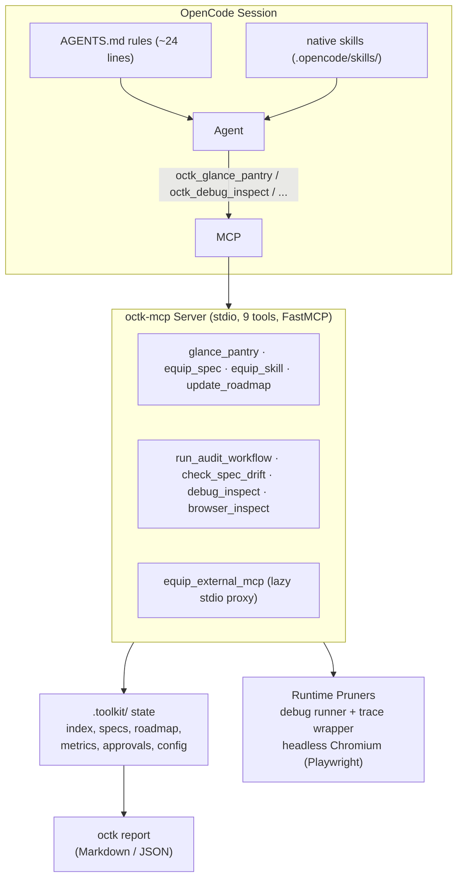
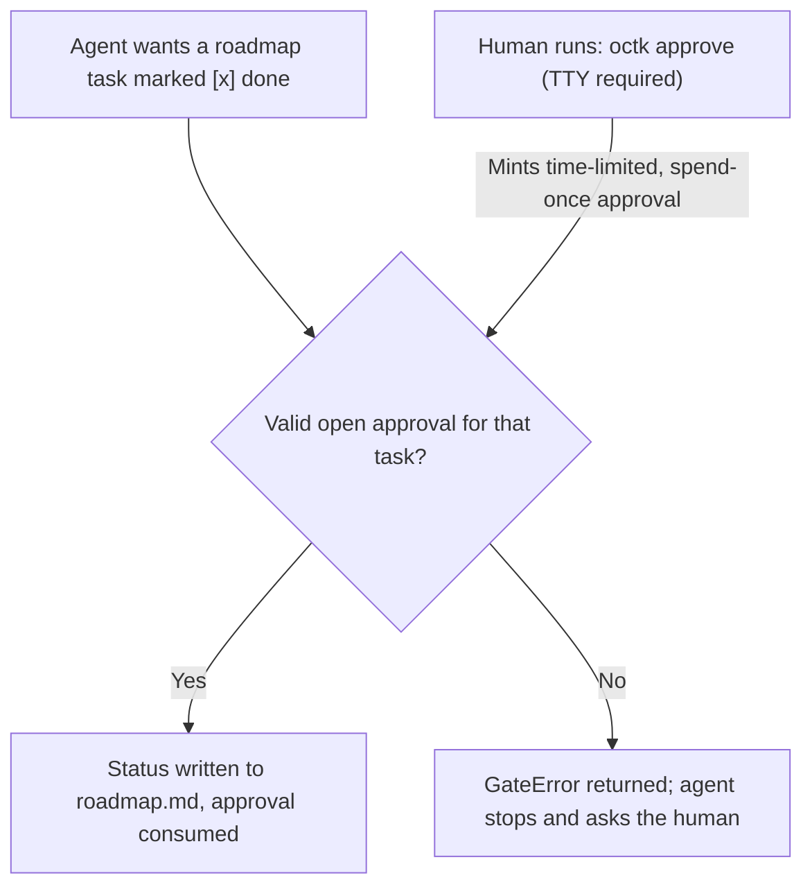

# octk — The OpenCode Toolkit


Just-In-Time Context Routing, TTY-Gated Human Approvals, and Runtime Pruners for AI Coding Agents.

**[Why octk?](#why-octk)** • **[5-Minute Quickstart](#5-minute-quickstart)** • **[Architecture](#architecture)** • **[Benchmarks](#benchmarks--honest-measurement-model)** • **[CLI & Tools Reference](#cli-reference)** • **[Architectural Provenance](#architectural-provenance-what-i-built-vs-what-i-borrowed--integrated)**

`octk` keeps an AI coding agent's context window tiny, gates roadmap completion behind out-of-band human approval, and records honest, verifiable metrics. It ships as a lightweight Python CLI (`octk`) plus a local Model Context Protocol server (`octk-mcp`) that OpenCode mounts automatically.

## Three Core Guarantees

- **Lazy Context ("The Chef's Pantry"):** Instead of dumping every markdown spec and skill into Turn 1, the agent starts with a 21-line rule file and a 1-page pantry index. Specs and skills load on demand; runtime debuggers and headless browser outputs are pruned down to project-local stack frames and actionable signals.
- **The TTY Approval Gate:** No agent can mark a roadmap item `[x]` done on its own. Running `octk approve "<task>"` in a real human terminal (TTY required) mints a time-limited, spend-once token that the agent must consume to check off a task.
- **Honest Telemetry:** Every logged number is strictly classified as `measured`, `counterfactual`, or `load`. Token savings are computed from real paired runs, and pruner signal retention is scored automatically—never assumed or hand-pasted.

## Why octk?

Coding agents lose time, money, and accuracy in three predictable ways:

| Common Agent Failure | What Happens Without octk | How octk Solves It |
|---|---|---|
| **1. Turn-1 Context Dumping** | The entire spec tree, skill files, and heavy tool schemas are injected on Turn 1—burning tens of thousands of input tokens before a single line of code is edited. | **JIT Pantry Router:** Serves a tiny 1-page index (`glance_pantry`) and equips specific specs/skills only when requested (+908 Turn-1 token delta vs. bare). |
| **2. Unverified Self-Approval** | Asked to "mark the roadmap done," an agent will edit the markdown file itself. Even if unit tests pass, the human never reviewed the change. | **Out-of-Band TTY Gate:** Blocks shell/file edits to `.toolkit/approvals.json` and requires a human terminal (`octk approve`) to mint a spend-once token. |
| **3. Unverifiable "90% Savings" Claims** | Tooling claims massive token reductions without showing raw-vs-pruned byte counts or proving that critical crash signals survived pruning. | **Scored Signal Retention:** Logs exact raw vs. pruned bytes and fails CI if any required crash signal (exception class, local var, HTTP 4xx/5xx) is lost. |

## 5-Minute Quickstart

### Step 1: Install octk (once on your computer)

Open your terminal, go into the `octk` folder, and sync the environment using `uv`:

```bash
cd path/to/octk
uv sync

# Optional: install headless Chromium once if you want browser inspection
uv run playwright install chromium
```

### Step 2: Initialize octk inside your project

Go to any coding project you want to work on and run `octk init`:

```bash
cd path/to/your-project
octk init
```

What this creates automatically:

- `AGENTS.md` — A tiny (~24-line) traffic-cop file telling the agent how to use the pantry.
- `.toolkit/` — Your project's specs, roadmap, config, and metrics store.
- `.opencode/` — Pre-configured multi-model agents (`plan`, `build`, `explore`, `verifier`), the `/ideate` command, and `opencode.json`.

### Step 3: Connect octk to OpenCode

Print the ready-to-use configuration snippet and make sure it is in your project's `opencode.json`:

```bash
octk mcp-config
```

```json
{
  "mcp": {
    "servers": {
      "octk": {"type": "local", "command": ["octk-mcp"], "codemode": false}
    }
  },
  "permissions": [
    {"action": "shell", "resource": "octk approve *", "effect": "deny"},
    {"action": "edit", "resource": ".toolkit/approvals.json", "effect": "deny"},
    {"action": "edit", "resource": ".toolkit/metrics.json", "effect": "deny"},
    {"action": "edit", "resource": ".toolkit/specs/roadmap.md", "effect": "ask"}
  ]
}
```

> **One-Time Safety Check:** After merging the snippet into `opencode.json`, verify that the `octk approve *` shell rule is set to `"deny"` and `.toolkit/approvals.json` edits are blocked. These permission rules stop a drifting agent, while the TTY check inside `octk approve` provides the hard gate.

### Step 4: Run your first task & approve it!

Now you can plan, code, approve tasks, and generate reports:

```bash
# 1. Start tracking a task
octk task start build-login --mode with_octk --model opencode-go/deepseek-v4.1-flash

# 2. Launch OpenCode (run /ideate to design specs, or ask the agent to build your task)
opencode

# 3. When the agent finishes and asks for your approval, run this in YOUR terminal:
octk approve "build-login"

# 4. Close the task and view your telemetry report
octk task end --status completed --tokens-in 12500 --tokens-cached 9800 --tokens-out 1800 --turns 5 --check "pytest -q"
octk report
octk doctor
octk handoff
```

## Architecture



- **AGENTS.md** is the only always-loaded surface: ~24 rendered lines on Turn 1.
- **Native** `.opencode/skills/` stay native: `octk_equip_skill` serves only supplemental project files placed in `.toolkit/skills/`.
- **Configurable Namespace:** `AGENTS.md` references tools using the configured `server_name` (default `octk`); the OpenCode server key in `opencode.json` defaults to `octk` and can be aligned with it.

## The Approval Gate



## Session Safety & Cache Hygiene

Five guardrails keep long sessions from degrading (and keep provider prefix caching intact):

- **2-Strike Circuit Breaker:** `debug_inspect` hashes `(command, returncode, first error line)`. The second consecutive identical failure appends an explicit override authorizing a raw shell retry or human escalation; any success or new task resets the streak.
- **1-File Fast-Path:** when the prompt names one file and a self-contained small fix, `AGENTS.md` authorizes skipping `glance_pantry` / `equip_spec` and editing directly. The root file remains a fixed template with no timestamps or live task state, so the provider prefix stays byte-stable.
- **Cache Telemetry & Doctor:** `octk task end --tokens-cached N` records `cache.read` tokens and reports `cache_hit_rate = cached / (input + cached)`. `octk doctor` warns about dynamic `AGENTS.md` text and missing approval-gate deny rules.
- **Lazy External MCPs:** configure stdio servers under `external_mcps`; Turn 1 shows only a one-line description. `equip_external_mcp` connects on demand to list tools or call one.
- **Context Handoff:** `octk handoff` snapshots roadmap state, `git status` / `git diff --stat`, the latest runtime signal, open approvals, and a 3-line resume prompt. A new session can hydrate it with `equip_spec("handoff")`.

## Benchmarks & Honest Measurement Model

Every metric recorded by `octk` is tagged by how it was obtained:

- **measured** — Exact raw bytes captured vs. exact pruned bytes returned. Headline numbers come strictly from here.
- **counterfactual** — The small returned payload is real; the "what would have been loaded on Turn 1" payload is estimated from the spec/skill tree. Kept in a separate report section.
- **load** — Context overhead added by `octk` itself (MCP tool schema bytes and `equip_*` calls).

**Token Proxy vs. Exact Standing Costs:** Tool-call reports label tokens as `approx` (chars / 4). Turn-1 standing costs (below) are the exception—they are recorded from exact provider token readouts.

### Standing Context Costs (Exact Turn-1 Input Tokens)

`octk standing add <label> --tokens-in N` records an exact Turn-1 input token count (`input + cache.read` from the provider's usage readout) comparing a bare repository against an `octk`-enabled repository:

| Label | Turn-1 Input Tokens | Delta vs. bare |
|---|---|---|
| bare | 6,823 | +0 |
| octk | 7,731 | +908 |

### Repo Dogfood Benchmark (Paired Tasks: with_octk vs. without_octk)

| Task | dur_with (s) | dur_without (s) | dur_%red | turns_with | turns_without | turns_%red | tok_with | tok_without | tok_%red | Acceptance |
|---|---|---|---|---|---|---|---|---|---|---|
| roadmap-gate | 19.6 | 26.4 | 25.7% | 6 | 8 | 25.0% | 61,645 | 91,957 | 33.0% | pass |
| pantry-desc | 25.5 | 25.7 | 0.5% | 7 | 7 | 0.0% | 102,380 | 86,718 | -18.1% | pass |
| metrics-tokens | 24.5 | 20.6 | -19.4% | 6 | 7 | 14.3% | 85,011 | 101,565 | 16.3% | pass |
| debugger-locals | 213.9 | 141.8 | -50.8% | 30 | 18 | -66.7% | 902,532 | 483,855 | -86.5% | pass |
| scaffold-gitignore | 21.1 | 19.2 | -10.0% | 7 | 7 | 0.0% | 96,948 | 69,201 | -40.1% | pass |

### What the Dogfood Numbers Show

- **Where `octk` wins (`roadmap-gate`, `metrics-tokens`):** On multi-file spec/state tasks, `octk` successfully cut turns by 14.3%–25.0%, wall-clock time by up to 25.7%, and total tokens by 16.3%–33.0%.
- **Where `octk` pays a fixed tax (`pantry-desc`, `scaffold-gitignore`):** On trivial 1-file edits against an empty bare repo, mounting the 8 MCP tool schemas and calling `glance_pantry()` adds a predictable baseline token schema tax.
- **The self-referential `debugger-locals` anomaly (now guarded):** The `debugger-locals` task required fixing a bug *inside* `octk_debug_inspect`. Because `octk` strictly forces the agent to use `octk_debug_inspect` for testing, the agent recursively attempted to use the broken debugger to debug the broken debugger, hitting an `allowed_commands` guardrail and looping for 30 turns (vs. 18 turns in bare bash). The 2-Strike Circuit Breaker now authorizes an explicit bypass after two identical failures.

> Skills, MCP servers, and plugins must be identical in both worktrees—or off in both. The only allowed asymmetry is `octk`'s own MCP entry, its `AGENTS.md` rules, and its `.toolkit/` state (with `bare` as the inverse). Review/critique skills are pinned to an exact version, never `latest`. Identical model, identical prompts, and identical acceptance commands in both arms. Results are published strictly from generated reports; nothing is hand-pasted.

## Tool Bench & Signal Retention

```bash
octk bench tools               # Writes reports/BENCH_TOOLS.md
uv run octk bench tools --json # Outputs raw benchmark results as JSON on stdout
```

The tool bench builds throwaway fixtures in temporary directories, runs the pruners for real, and scores two orthogonal metrics per case:

1. **Character Savings** (raw bytes vs. pruned bytes).
2. **Signal Retention** (the exact fraction of required debugging signals—test name, exception class, local variable values, console errors, HTTP 4xx/5xx failures—that survive pruning).

Retention is scored, never assumed: the CLI exits 1 if any non-skipped case loses a single required signal. Browser cases are marked skipped (never faked) when headless Chromium is unavailable. See the committed report in [`reports/BENCH_TOOLS.md`](reports/BENCH_TOOLS.md).

## CLI Reference

| Command | Purpose |
|---|---|
| `octk init [--force]` | Idempotently scaffold `AGENTS.md`, `.toolkit/`, `.opencode/agents`, and `opencode.json` |
| `octk mcp-config` | Print the `opencode.json` MCP & permissions snippet (V2 syntax) |
| `octk models` | List the 4 octk agents (`plan`, `build`, `explore`, `verifier`) and their model/effort |
| `octk set-model <agent> <model>` | Update an agent's assigned LLM model |
| `octk set-effort <agent> <level>` | Update an agent's reasoning effort level (`low`, `medium`, `high`, `xhigh`, `max`) |
| `octk task start <task> --mode ... --model ...` | Open a tracked task run in `.toolkit/metrics.json` |
| `octk task end --status ... --tokens-in N --tokens-cached N ...` | Close a task run with verification check and cache-read results |
| `octk approve "<task>"` | Mint a one-time, TTY-gated human approval token |
| `octk report [--json]` | Build the telemetry comparison report in Markdown or JSON |
| `octk doctor [--json]` | Check prefix-cache stability (`AGENTS.md`) and approval-gate deny rules |
| `octk handoff [--out .toolkit/handoff.md]` | Write a deterministic resume snapshot (roadmap, git, runtime, approvals) |
| `octk standing add <label> --tokens-in N` | Record an exact Turn-1 input token count (bare vs. octk) |
| `octk bench tools [--out PATH] [--json]` | Run pruner benchmarks and signal-retention checks on generated fixtures |

**OpenCode Slash Commands:** Run `/ideate` inside OpenCode to launch the interactive specification architect, stress-test blueprints, and populate `.toolkit/specs/`.

## The Nine MCP Tools

| Tool Name | Reads / Writes | What It Returns | Telemetry Kind |
|---|---|---|---|
| `*_glance_pantry` | `.toolkit/index.md`, spec/skill names | 1-screen inventory + measured raw/pruned byte delta | `counterfactual` |
| `*_equip_spec` | `.toolkit/specs/<name>.md` | Full specification text on demand | `load` |
| `*_equip_skill` | `.toolkit/skills/<name>.md` | Supplemental project skill text on demand | `load` |
| `*_update_roadmap` | `.toolkit/specs/roadmap.md` | Gate-enforced `[x]` / `[~]` / `[ ]` status update | `measured` |
| `*_run_audit_workflow` | Dependency graph timestamps | Freshness check + `graphify` / `ponytail-review` advice or run | `measured` |
| `*_check_spec_drift` | Live `.py` AST vs. `architecture.md` | Deterministic 0-token Python AST spec-drift report | `measured` |
| `*_debug_inspect` | Allowlisted `pytest` / `python` run | Pruned failure traceback (project frames + `locals()` signals) | `measured` |
| `*_browser_inspect` | `http` / `https` URL | Headless Chromium summary (interactive selectors + console/net errors) | `measured` |
| `*_equip_external_mcp` | `.toolkit/config.json` external server | Lazy stdio MCP tool list/schemas or one tool result; unknown servers rejected | `load` |

## Configuration & Cross-Platform Support

### `.toolkit/config.json`

| Key | Default | Meaning |
|---|---|---|
| `server_name` | `"octk"` | Prefix for every tool name rendered in `AGENTS.md` and config snippets |
| `always_on_skills` | `[]` | Skills named in `AGENTS.md`'s 1-line always-on rule |
| `audit_mode` | `"instruct"` | `"instruct"` advises (`/graphify .` then `/ponytail-review`); `"subprocess"` runs configured executables |
| `graph_cmd` | `"graphify"` | Executable used for graph freshness checks in subprocess audit mode |
| `audit_cmd` | `"ponytail-review"` | Executable used for code-reuse audits in subprocess audit mode |
| `graph_report_paths` | `["graphify-out/GRAPH_REPORT.md", "graphify-out/graph.json"]` | File paths checked for dependency graph freshness |
| `allowed_commands` | `["pytest", "python", "python3", "uv"]` | Subprocess execution allowlist (never uses a shell) |
| `external_mcps` | `{}` | Lazy stdio MCP servers: `{"name": {"command": ["exe", "arg"], "description": "one line"}}` |
| `external_mcp_timeout_s` | `30` | On-demand external MCP connect/list/call timeout |
| `command_timeout_s` / `max_output_chars` | `120` / `2500` | Subprocess runner guardrails |
| `approval_ttl_minutes` | `120` | Expiration window for minted human approval tokens |

### Windows & Cross-Platform Notes

- **Path Normalization:** The traceback pruner normalizes `/` and `\` separators and filters `.venv`, `venv`, `site-packages`, `Lib\site-packages`, `.venv\Scripts`, `node_modules`, and `__pycache__` frames as third-party noise across Windows, macOS, and Linux.
- **Line Endings:** The roadmap parser uses `splitlines()` and preserves existing CRLF / LF line endings on write.
- **Subprocess Safety:** Executables are resolved via `shutil.which`; subprocesses are never invoked with `shell=True`.

## Development & Testing

```bash
uv sync
uv run pytest -q                   # Run full 123-test suite (includes headless-Chromium tests)
uv run pytest -q -m "not browser"  # Run unit & integration tests without Playwright
uv run playwright install chromium # One-time browser setup
```

Internal design conventions live in [`docs/DESIGN.md`](docs/DESIGN.md) (module map, telemetry kinds, purity rules, atomic file writes, and honesty invariants). Generated benchmark reports are committed under `reports/`, while machine state (`.toolkit/metrics.json`, `.toolkit/approvals.json`, `graphify-out/`, `.venv/`) is gitignored.

## Architectural Provenance: What I Built vs. What I Borrowed & Integrated

### 1. What I Built From Scratch (Core `octk` Engineering)

- **`octk-mcp` ("Chef's Pantry" FastMCP Server):** Custom Python MCP router (`glance_pantry`, `equip_spec`, `equip_skill`) that replaces Turn-1 context dumping with Just-In-Time (JIT) lazy-loading of modular specs and skills.
- **Runtime Traceback & DOM Pruners:** Custom wrappers around `pytest`/`pdb` (`debug_inspect`) that strip third-party `site-packages`/`.venv` stack frames to expose local variables at crash points, and headless Chromium (`browser_inspect`) that prunes raw HTML DOMs down to interactive selectors, console errors, and 4xx/5xx network failures.
- **Zero-Token AST Spec-to-Code Drift Scanner (`check_spec_drift`):** Deterministic Python `ast` parser that compares live classes, function signatures, and routes against `.toolkit/specs/architecture.md` without burning LLM tokens.
- **Multi-Model Quota Router & Agent Scaffolding (`octk init`, `octk set-model`, `octk set-effort`):** Pre-configured primary (`plan`, `build`) and subagent (`@explore`, `@verifier`) definitions that route high-IQ design to frontier models and offload noisy test loops and codebase searches to high-quota/free models.
- **HITL State Gate & Telemetry Engine (`metrics.py`, `octk approve`, `octk report`):** Programmatic TTY-gated token system blocking unapproved roadmap completion and automated benchmarking logger tracking wall-clock time, raw-vs-pruned byte savings, and signal retention.

### 2. Methodologies & Design Patterns Adapted (With Credit)

- **Elephant-Goldfish Model (EGM) by Dave Rensin / Google (`github.com/google/elephant-goldfish-model`):**
  - *What I borrowed:* The conceptual split between a deep-context "Elephant" architect (`plan` agent in `/ideate`) and a stateless, zero-context "Goldfish" reviewer (`@verifier` subagent) to stress-test specs before writing code, plus the concept of spec-to-code drift detection and `<!-- OCTK:START -->` sentinel-block upserting.
  - *How I adapted it for `octk`:* Replaced EGM's heavy 7-agent concurrent review swarm (which exhausts consumer request quotas) with a single zero-context `@verifier` running on unlimited/high-quota tiers and a deterministic 0-token Python `ast` drift scanner inside `octk-mcp`.
- **MCP "Code Mode" / Progressive Disclosure Pattern:**
  - *What I borrowed:* The concept of exposing a lightweight index tool instead of injecting dozens of heavy tool schemas and markdown files into the initial system prompt.

### 3. External Tools & Plugins Orchestrated (Not Built by Me)

- **OpenCode (`opencode.ai`):** The underlying CLI coding harness that mounts `octk-mcp` and executes the agents.
- **`graphify` & `ponytail`:** External dependency-graph generator and code-reuse auditing plugin; `octk` wraps them inside `run_audit_workflow()` to automatically verify graph freshness by file timestamp before running code-reuse audits.
- **FastMCP (`mcp` Python SDK), Playwright, & Pytest:** Underlying open-source libraries powering the MCP transport, headless browser automation, and test execution.
