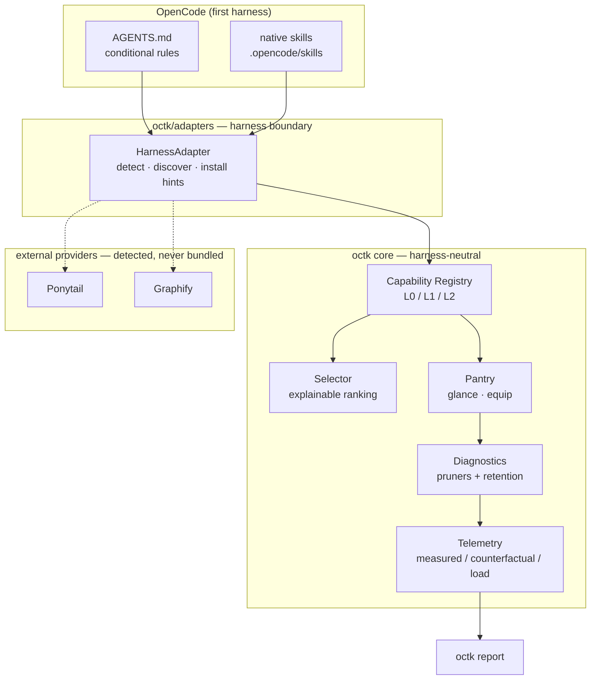
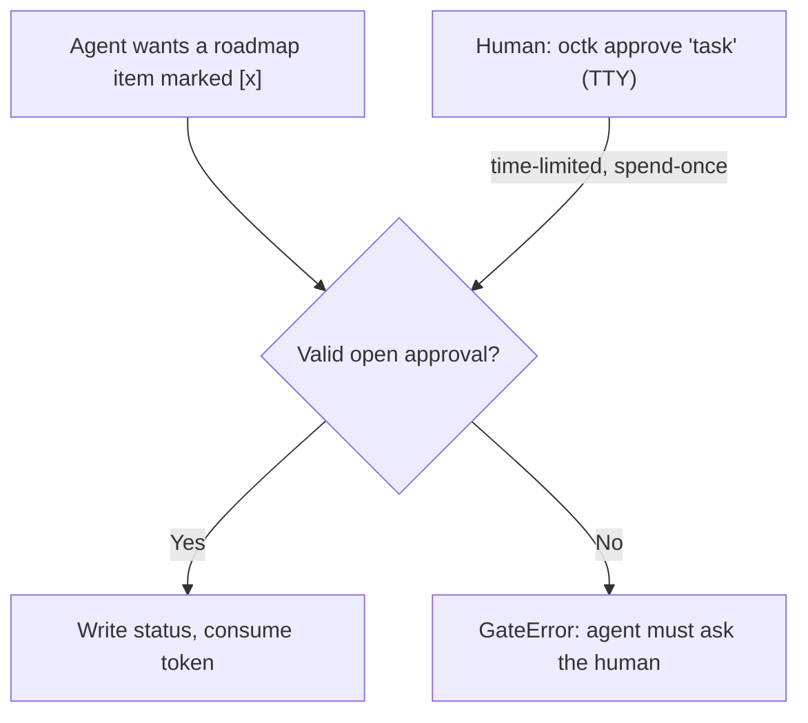

# octk — the information layer for coding agents


**Give coding agents the right information, at the right time, in the right
format — and prove it with numbers you can check.**

`octk` is a local CLI (`octk`) plus an MCP server (`octk-mcp`) that describes
the tools you already have, loads detail only when a task needs it, gates
consequential actions behind a human, and measures what actually happened.

> [!IMPORTANT]
> **We do not claim token savings.** In our 80-run benchmark (2026-11-11),
> OCTK kept correctness at **80/80** but used **21% more input tokens** and was
> **50% slower** than the same agent without it. The confidence interval for
> tokens crosses zero. Full numbers, method, and the architecture-vs-
> implementation breakdown: [`docs/v2/BENCHMARK_RESULTS.md`](docs/v2/BENCHMARK_RESULTS.md).

---

## Why this exists

Coding agents fail in three predictable ways:

| Failure | What it looks like | What octk does |
|---|---|---|
| **Context dumping** | Every spec, skill, and tool schema is injected on turn 1 | A tiny pantry index; specs load on demand |
| **Unverified self-approval** | The agent marks its own roadmap task `[x]` | A TTY-gated, spend-once approval token |
| **Unverifiable claims** | "90% fewer tokens" with no raw numbers | Every metric tagged `measured`, `counterfactual`, or `load` |

The fourth failure is the one we hit ourselves: **building the wrong benchmark**.
That is why the result above is published, not hidden.

## What it does

| Pillar | What you get |
|---|---|
| **Capability Registry** | A read-only inventory of skills, commands, plugins, MCP servers, and CLIs — with L0/L1/L2 detail |
| **Capability Selector** | Explainable relevance ranking: why a capability was picked or skipped |
| **Pantry** | `glance_pantry` inventory + `equip_spec` / `equip_skill` on demand |
| **Human gate** | `octk approve "<task>"` in a real terminal; the agent cannot self-approve |
| **Diagnostics** | Pruned tracebacks and browser snapshots with scored signal retention |
| **Honest telemetry** | Gross vs net, measured vs estimated, per task and per tool |

## Architecture



**Boundary rule:** core never imports a harness. Adding a second harness means
adding one adapter, not editing the core. `tests/test_boundaries.py` enforces it.

## Quickstart

```bash
# 1. Install (from source; PyPI packaging is prepared but not published)
git clone https://github.com/manaskumar1704/opencode-toolkit
cd opencode-toolkit
uv tool install --editable .

# 2. Scaffold a project
cd path/to/your-project
octk init

# 3. Print the OpenCode config and merge it
octk mcp-config
```

`octk init` creates:

- `AGENTS.md` — a short, static traffic-cop file
- `.toolkit/` — specs, roadmap, config, metrics, approvals
- `.opencode/agents/` — `plan`, `build`, `explore`, `verifier`
- `opencode.json` — the MCP entry, using the portable `octk-mcp` command

Then run `opencode` and ask for work. When the agent wants to mark a roadmap
item done:

```bash
octk approve "build-login"   # human terminal only
```

## Benchmark: what we measured

**Stage 1** — 8 task categories × 2 arms × 5 reps = 80 runs.
Cohort: OpenCode 2.2.6, `opencode-go/beam-free`, effort `high`.
Isolation: standalone workspace, `bwrap`, private `/tmp`, hidden oracle.

| Metric | A (OCTK off) | E (OCTK on) |
|---|---:|---:|
| Correctness | **40/40** | **40/40** |
| Input tokens, mean | 10,003 | 12,130 (**+21.3%**) |
| Input tokens, 95% CI | — | −46.7%..+0.8% (crosses zero) |
| Duration, mean | 29.5s | 44.2s (**+49.8%**) |
| Duration, 95% CI | — | −106.7%..−2.5% (significant slowdown) |

**Gate:** paired bootstrap, 5,000 resamples, minimum 5% token or 10% duration
effect. Result: **no measurable efficiency signal → Stage 2 blocked.**

### Per task

| Task | A tokens | E tokens | Δ |
|---|---:|---:|---:|
| architecture_drift | 6,442 | 8,381 | +30.1% |
| browser_issue | 3,183 | 3,589 | +12.8% |
| capability_overlap | 2,999 | 3,443 | +14.8% |
| multi_file_feature | 18,577 | 28,690 | +54.4% |
| refactor | 6,296 | 4,673 | **−25.8%** |
| repo_exploration | 8,709 | 9,598 | +10.2% |
| simple_bug | 5,110 | 3,805 | **−25.5%** |
| test_diagnosis | 22,214 | 24,824 | +11.7% |

### What we learned

| Layer | Finding |
|---|---|
| **Architecture** | A fixed MCP schema tax of **~500 tokens per run**. v1 measured the same floor: bare 6,823 → octk 7,731 (**+908 turn-1 tokens**) |
| **Implementation** | `check_spec_drift` dumped 11k chars per call; `glance_pantry` was mandatory and called 25 times; `equip_spec` added ~1k chars per call |
| **Harness** | `/tmp` exposed pytest artifacts containing oracle copies; one pre-fix run spent 22 steps hunting them |
| **Benchmark design** | All 8 tasks are small-repo edits. The pantry only pays off when the baseline would otherwise load many specs/skills |

**Verdict:** the fixed overhead is architectural but modest. The gap is mostly
implementation (tool output volume, extra steps) plus a suite that cannot
exercise the pantry's intended win. The idea is untested at the scale where it
matters — not disproven.

### v1 was mixed too

| v1 task | With OCTK | Without | Δ |
|---|---:|---:|---:|
| roadmap-gate | 61,645 | 91,957 | −33.0% |
| metrics-tokens | 85,011 | 101,565 | −16.3% |
| pantry-desc | 102,380 | 86,718 | +18.1% |
| scaffold-gitignore | 96,948 | 69,201 | +40.1% |

The same pattern: wins where exploration is expensive, losses where the task is
small enough that the fixed tax dominates.

## Capability registry

The registry describes what you already have. It never copies skill bodies and
never invokes anything during discovery.

```bash
$ octk capabilities discover          # dry run
$ octk capabilities discover --write  # update .toolkit/capabilities/index.json
$ octk capabilities list --level L1
$ octk capabilities select "review frontend design"
```

```
Task terms: design, frontend, review
Selected (3):
  design-taste-frontend [skill] score=0.67 - matched design, frontend
  imagegen-frontend-web [skill] score=0.67 - matched design, frontend
  free-tier-deploy [skill] score=0.33 - matched frontend
Skipped (2):
  high-end-visual-design [skill] - lower rank than the selected set (matched design)
  imagegen-frontend-mobile [skill] - lower rank than the selected set (matched frontend)
```

Disclosure levels:

| Level | Contents | When |
|---|---|---|
| **L0** | Grouped names only | Always |
| **L1** | Invocation, permissions, availability | When asked |
| **L2** | Full instructions / schema | Only when the task needs it |

## The approval gate



The gate is **policy-enforced**, not a sandbox: an agent with unrestricted shell
access can still edit files. `octk doctor` checks that the OpenCode deny rules
are present, and the README says so plainly.

## MCP surface — 8 tools

| Tool | Purpose | Cost |
|---|---|---|
| `glance_pantry` | Compact inventory | small |
| `equip_spec` | Load one spec | medium |
| `equip_skill` | Load one extra skill | medium |
| `equip_external_mcp` | Inspect/call a configured external MCP | on demand |
| `debug_inspect` | Pruned test traceback | measured |
| `browser_inspect` | Headless Chromium summary | measured |
| `check_spec_drift` | Python-AST drift report (capped at 20 items/section) | measured |
| `capability_registry` | L0/L1/L2 registry view | small |

Demoted to CLI to keep the schema lean:

- `run_audit_workflow` → `octk audit`
- `update_roadmap` → `octk roadmap set`

`OCTK_BROWSER=0` drops `browser_inspect` and its schema.

## Honest measurement model

Every number is tagged:

- **measured** — raw bytes in, pruned bytes out, provider token readouts
- **counterfactual** — what *would* have been loaded, clearly separated
- **load** — the overhead OCTK itself adds

Rules:

1. Correctness is a hard gate. Efficiency never compensates for a regression.
2. Gross and net savings are reported separately.
3. Character savings are not token savings.
4. A run missing any integrity field is `INVALID`, not defaulted.
5. No performance claim without a measured run.

## CLI reference

| Command | Purpose |
|---|---|
| `octk init [--force]` | Scaffold `AGENTS.md`, `.toolkit/`, agents, `opencode.json` |
| `octk mcp-config` | Print the MCP + permissions snippet |
| `octk capabilities {list,show,discover,verify,select,register}` | Registry and selector |
| `octk providers` | Ponytail / Graphify status (detect only) |
| `octk task start` / `task end` | Task bookkeeping and acceptance check |
| `octk approve "<task>"` | Mint a TTY-gated, spend-once approval |
| `octk report [--json]` | Markdown/JSON telemetry report |
| `octk doctor` | Prefix-cache and gate health |
| `octk handoff` | Deterministic resume snapshot |
| `octk standing add` | Record an exact turn-1 token cost |
| `octk audit` | Graph-freshness + audit workflow |
| `octk roadmap set` | Gate-enforced roadmap status |
| `octk bench tools` | Pruner + signal-retention benchmark |
| `python -m benchmarks.driver --stage 1 --dry-run` | Inspect the factorial queue (dev-only) |

## Status

- **v2 core:** registry, selector, adapters, providers, diagnostics, telemetry — done.
- **Stage 1:** executed; correctness parity, no efficiency signal. Stage 2 blocked.
- **Next:** a large-context task (~20 specs/skills) that can actually test the
  pantry thesis; then the Terminal-Bench 2.0 adapter; then Phase B security.
- **Not shipped:** PyPI release, second harness (Codex), MCP reduction below 8.

## Provenance

`octk` is built, not borrowed. Ponytail and Graphify are **external providers**:
detected if installed, never bundled, forked, or reimplemented. Discovery never
executes a capability; no config is mutated silently.

## License

MIT. See [`LICENSE`](LICENSE).
